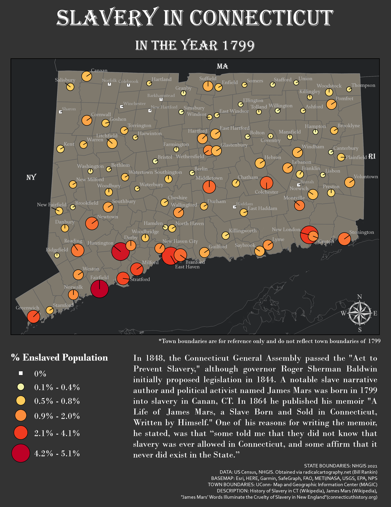

{fig-align="center" width="497"}

### *Tools Used*

[ArcGIS Pro]{.badge .rounded-pill .bg-success}

### *Description*

The goal of this project was to address challenges in statistical mapping by learning and applying different techniques, classification schemes, and symbolization methods to a dataset containing the population of enslaved individuals during 1799 in Connecticut by town. A second map (not shown) was also created for this project which purposefully used misleading map design in order to overstate the enslaved population. The data used in this project originates from from radicalcartography.net.

Overall, this project allowed me to improve on my ability to critically examine maps created by others and improve the design and communication of my own maps.
